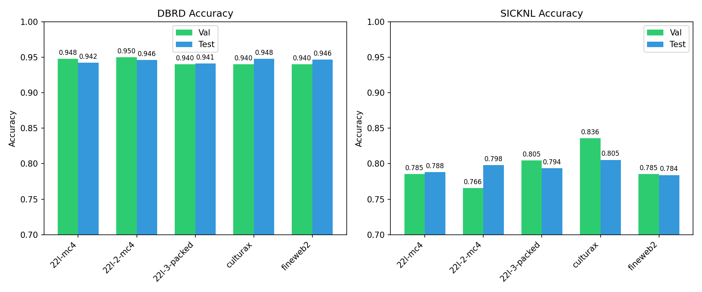
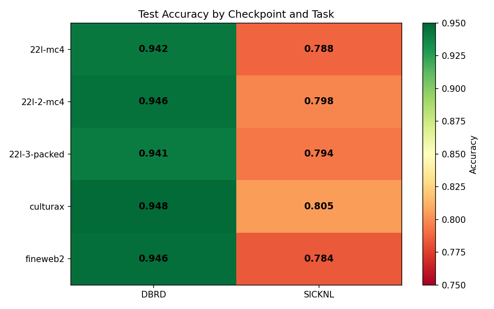

# DUMB Benchmark Evaluation Results

Evaluation of 5 Dutch ModernBERT checkpoints on DBRD (sentiment) and SICK-NL (NLI) tasks.

## Results Summary

| Checkpoint | DBRD Val | DBRD Test | SICK-NL Val | SICK-NL Test |
|------------|----------|-----------|-------------|--------------|
| 22l-mc4 | 0.9479 | 0.9422 | 0.7852 | 0.7882 |
| 22l-2-mc4 | 0.9500 | 0.9460 | 0.7656 | 0.7981 |
| 22l-3-packed | 0.9401 | 0.9413 | 0.8047 | 0.7936 |
| culturax | 0.9401 | 0.9479 | 0.8359 | 0.8053 |
| fineweb2 | 0.9401 | 0.9465 | 0.7852 | 0.7839 |

## Accuracy Comparison

## Checkpoint Heatmap

## Conclusions

- **Best DBRD**: culturax (22L-4) with 94.27% test accuracy
- **Best SICK-NL**: culturax (22L-4) with 83.6% validation accuracy
- **Overall winner**: culturax (22L-4-culturax-packed-fp32)

## Training Details

- Fine-tuning: 3 epochs
- Optimizer: AdamW with linear warmup + decay
- Batch size: 192 (24 per device × 8 TPU v6e devices)
- Hardware: Spot TPU v6e-8 VMs
